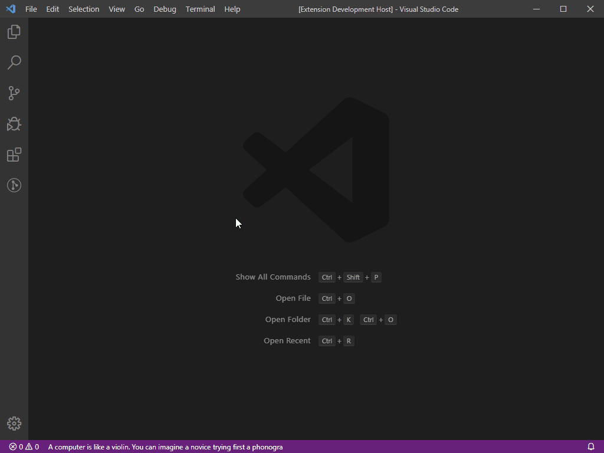

# StatusBar Quotes for Visual Studio Code

**Keep your principles in sight while you code.**

StatusBar Quotes is a quiet personal motivation quote system for VS Code. It keeps the values, principles, and goals you do not want to forget in the status bar while you work — without notification loops, feeds, or noisy UI.



## Why use it?

When you are deep in implementation, it is easy to forget the bigger principles that matter: ship small, verify honestly, stay close to the user, protect focus, or keep going through a hard debugging session.

This extension keeps those custom quotes in the same place where the drift happens: your editor.

## Features

- Quiet status bar custom quotes that rotate while you code
- Add your own custom quotes
- Create and manage custom quote categories
- Use built-in quote categories as starter packs
- Shuffle the current custom quote on demand
- Click the status bar text to read the full quote
- Choose English or Korean built-in quotes
- Configure the display interval, including `0` to keep one quote visible

## Custom Quotes

Create your own quote system from the Command Palette:

- `StatusBar Quote: Add Custom Category`
- `StatusBar Quote: Add Custom Quote`
- `StatusBar Quote: Manage Custom Categories`
- `StatusBar Quote: Manage Custom Quotes`
- `StatusBar Quote: Change category`

Example categories:

- My Principles
- Debugging Mindset
- Founder Mode
- Deep Work
- Burnout Recovery

Example custom quotes:

- `Ship small, verify honestly.`
- `Stay close to the user.`
- `Make the important thing easy to see.`

Custom quotes are local-first. They are stored in the `statusbar-quotes.custom-quotes` setting, so you can manage them through Settings JSON or the Command Palette. They are not sent to a server by this extension.

## Built-in categories

- Wise Saying
- Programming
- Startup
- How to Win Friends and Influence People (Dale Carnegie)

## Languages

Built-in quote languages:

- English
- Korean

Custom quotes are shown exactly as you write them and are not filtered by the language setting.

## Settings

- `statusbar-quotes.category` — choose a built-in category, or choose `Choose Custom Category...` to open the category picker for custom categories
- `statusbar-quotes.language` — choose English or Korean built-in quotes
- `statusbar-quotes.display-seconds` — quote rotation interval in seconds
  - Range: `0` to `86400`
  - Set to `0` to keep the current quote visible
- `statusbar-quotes.display-shuffle-button` — show or hide the shuffle button

Custom categories are selected at runtime through `StatusBar Quote: Change category` so they do not need to be written into the extension manifest category enum.

### Manage Custom Quotes in Settings JSON

You can also edit custom quotes directly in VS Code Settings JSON:

```json
"statusbar-quotes.custom-quotes": {
    "version": 2,
    "categories": {
        "My Principles": [
            "Ship small, verify honestly.",
            "Stay close to the user."
        ],
        "Debugging Mindset": [
            "Read the error twice.",
            "Reproduce before fixing."
        ]
    }
}
```

Category names are the keys, so you do not need to copy internal IDs when adding or moving quotes.

## Design principles

- Quiet by default
- Personal motivation over generic quote volume
- No default popups or notification loops
- No accounts, feeds, rankings, or AI-generated content as core behavior
- Built to preserve developer focus

## Quotes from

- Wise saying
    - https://www.inc.com/lolly-daskal/100-motivational-quotes-that-will-inspire-you-to-succeed.html
    - http://www.heartsaying.com/archives/3807
    - https://brunch.co.kr/@jade/367
    - http://www.heartsaying.com/archives/3974
- Programming
    - https://dzone.com/articles/more-good-programmingquotes
    - https://www.goodreads.com/quotes/tag/programming
    - https://github.com/AntJanus/programmers-proverbs
    - https://okky.kr/article/463386?note=1437458
    - https://blog.fupfin.com/?p=11
    - http://m.todayhumor.co.kr/view.php?table=humorbest&no=1154153
    - https://www.devglan.com/blog/best-developer-quotes
- Startup
    - http://somedaybiz.com/1964
    - https://onlinebiz.kr/창업자가-기억해야-할-격언-100가지/
    - https://www.forbes.com/sites/allbusiness/2014/02/10/50-inspirational-quotes-for-startups-and-entrepreneurs/#4c3c18c6ef05
    - https://kaushalrajpopat.wordpress.com/2012/08/20/series-i-of-inspiring-entrepreneur-startup-quotes/
    - https://www.thearthunters.com
- How to Win Friends and Influence People (Dale Carnegie)
    - https://www.amazon.com/How-Win-Friends-Influence-People/dp/0671027034/

## You may also like

- [Flashcards](https://marketplace.visualstudio.com/items?itemName=kim-sardine.flashcards)
